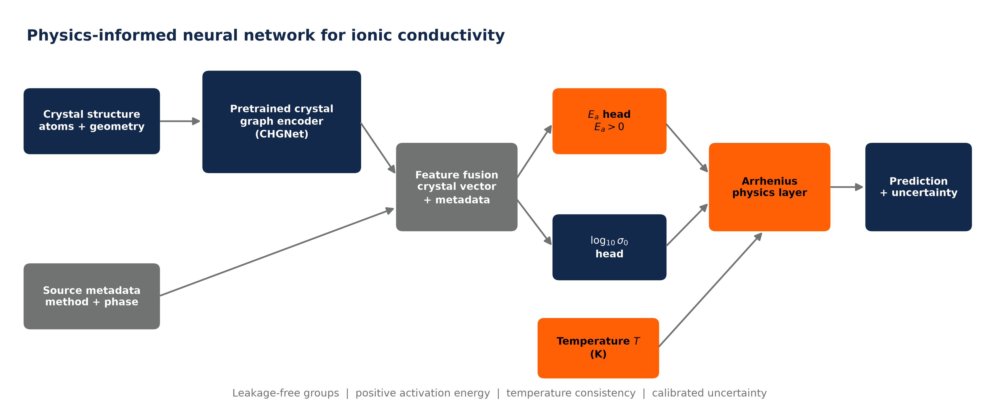

# Physics-Informed Neural Network and Multiscale Simulations for Lithium-Ion Conductors

This senior-design project develops a physics-informed neural network to predict lithium-ion conductivity from chemical composition, crystal structure, temperature, and documented measurement conditions. The trained model will guide the selection of representative materials and variables for later multiscale simulations.

## Research objective

Ionic conductivity is commonly measured experimentally or estimated using computationally expensive atomistic simulations. This project first builds a data-driven screening model that predicts conductivity and reports uncertainty, then uses the resulting trends to prioritize a smaller set of materials for detailed physical simulation.

The machine-learning target is

$$
y=\log_{10}\!\left(\frac{\sigma_{\mathrm{ion}}}{1\ \mathrm{S\,cm^{-1}}}\right).
$$

Temperature dependence is introduced through the Arrhenius relation

$$
\widehat{\log_{10}\sigma(T)}=
\widehat{\log_{10}\sigma_0}
-\frac{\widehat E_a}{k_{\mathrm B}T\ln 10},
$$

where the neural network learns a positive activation energy $\widehat E_a$ and conductivity prefactor $\widehat{\sigma_0}$ from the material representation.

## Modeling approach

The planned primary model is a **Physics-Informed Arrhenius Crystal Graph Neural Network (PI-ACGNN)**:

- A pretrained crystal graph encoder, initially CHGNet, represents atoms and their periodic local environments.
- The first trainable head predicts room-temperature conductivity and data-dependent uncertainty.
- Activation-energy, prefactor, and Arrhenius physics heads are added only after multi-temperature labels make them identifiable.
- A multi-seed ensemble estimates model uncertainty.
- A composition-only multilayer perceptron and an unconstrained crystal graph network provide neural-network baselines.

All measurements for the same material remain in the same validation fold. A stronger generalization test holds out complete chemical systems so that reported performance reflects unfamiliar chemistry rather than duplicate-material leakage.

## Data foundation and project advancement

The first supervised source is [OBELiX](https://doi.org/10.1039/d5dd00441a), a peer-reviewed dataset of 599 experimental room-temperature lithium solid-electrolyte records. The official data include composition, space group, lattice parameters, source DOI, and 321 associated CIF structures and are distributed under CC BY 4.0 through the [NRC-Mila repository](https://github.com/NRC-Mila/OBELiX).

The project uses the literature benchmark as a foundation and adds the following developments:

- A provenance-preserving project schema with explicit unit, source, phase, structure-match, and nominal-temperature fields.
- Correct handling of 37 censored upper-bound values instead of treating them as exact regression labels.
- Connected validation groups that keep records sharing either material identity or source DOI together.
- Transfer learning and uncertainty calibration designed for the small structure-labeled subset.
- An identifiability gate that prevents fitting physical-looking Arrhenius parameters from room-temperature-only data.
- A path from ML-selected variables and materials to later DFT, MD, and phase-field simulations.

## Connection to multiscale simulation

The current four-week phase is entirely focused on data analysis and machine learning. After the model identifies influential variables and representative materials, the project can progress across physical scales:

1. **Density functional theory (DFT):** calculate defect energetics, stable structures, and selected lithium migration barriers.
2. **Molecular dynamics (MD):** estimate temperature-dependent lithium diffusion and conductivity.
3. **Phase-field modeling (PFM):** study how mesoscale structure, interfaces, and spatial heterogeneity affect transport.

The neural network is therefore a screening and hypothesis-generation tool, not a replacement for these simulations.

## Current contents

- `battery_materials_project.ipynb` — target definition, data contract, literature-backed audit, neural-network mathematics, and staged model design.
- `data/processed/ionic_conductivity_intake_template.csv` — schema for conductivity labels and source metadata.
- `data/raw/obelix_{all,train,test}.csv` — official OBELiX source tables and leakage-controlled split.
- `data/processed/obelix_conductivity_clean.csv` — 562 exact labels normalized to the project schema with linked validation groups.
- `data/processed/obelix_mlp_cv_results.csv` — linked-group validation results for six neural-network configurations.
- `data/processed/obelix_mlp_test_predictions.csv` — untouched-test predictions, ensemble spread, errors, and train-calibrated intervals.
- `data/processed/obelix_structure_manifest.csv` — provenance, hashes, parsing results, occupancy flags, and metadata checks for all 599 OBELiX records.
- `data/processed/obelix_mp_structure_match_pairs.csv` — composition, symmetry, and geometric results for each shortlisted OBELiX–MP pair.
- `data/processed/obelix_mp_structure_match_summary.csv` — one matching status per OBELiX record, including records outside the screened MP subset.
- `data/processed/mp_obelix_formula_search_metadata.csv` — Materials Project phases returned by the wider formula query without screening filters.
- `data/processed/obelix_mp_wide_match_{pairs,summary}.csv` — geometric comparisons and one status per OBELiX record from that wider query.
- `data/processed/obelix_occupancy_sensitivity.csv` — changes in composition, Li content, and atom count under two diagnostic site-occupancy thresholds.
- `data/processed/mp_li_solid_electrolyte_candidates.csv` — 5,068 Materials Project entries passing the broad stability, band-gap, and composition prescreen.
- `data/processed/mp_li_solid_electrolyte_domain_audit.csv` — candidate applicability flags; it intentionally contains no conductivity predictions.
- `figures/figure_01_physics_informed_conductivity_model.png` — project architecture figure using the UIUC brand palette.
- `figures/figure_02_obelix_data_audit.png` — label, split, structure-coverage, and repeatability audit.
- `figures/figure_03_mlp_and_mp_screening_gate.png` — neural-baseline validation and Materials Project screening decision.
- `figures/figure_04_obelix_structure_manifest.png` — structure provenance, metadata validation, and partial-occupancy audit.
- `figures/figure_05_obelix_mp_structure_matching.png` — first-pass structure matching counts in the UIUC palette.
- `figures/figure_06_mp_wide_and_occupancy.png` — wider matching yield and occupancy sensitivity in the UIUC palette.

The notebook retains the Materials Project setup for candidate crystal structures and structural descriptors. Because the existing local insertion-electrode cache does not contain ionic-conductivity labels, a separate conductivity table is required before training.

### Materials Project initialization

The notebook preserves the original cache-first Materials Project workflow. Normal execution reads `data/raw/mp_li_insertion_electrodes.json` without making a network request. To intentionally refresh the source, place `MP_API_KEY` in a local `.env` file and set `FORCE_MP_REFRESH = True`; the notebook negotiates fields supported by the current insertion-electrode endpoint and records the database version and returned fields in `data/raw/download_metadata.json`.

A second cache uses the official Materials Project summary endpoint to identify Li-containing, nonmetallic compounds with 3–6 elements, band gap at least 1 eV, and energy above hull no greater than 0.05 eV/atom. The current cache contains 5,068 unique materials from database version `2026.09.28`; set `REFRESH_MP_CANDIDATES = True` only when an intentional API refresh is required. The API key is never written to the notebook or project data files.

## Four-week ML plan

| Week | Primary outcome |
|---|---|
| 1 | Freeze the target and schema; collect, normalize, deduplicate, and audit conductivity records. |
| 2 | Resolve material identities and structures; create leakage-free splits; train the composition-only neural baseline. |
| 3 | Transfer-learn the crystal graph encoder and compare unconstrained and Arrhenius-constrained networks. |
| 4 | Calibrate uncertainty, run ablations, analyze influential variables, and select materials for later simulations. |

## Current status

The target, data contract, OBELiX audit, composition-only neural baseline, Materials Project consultation, and structure manifest now run end to end. The cleaned table contains 562 exact positive labels split into 449 training and 113 held-out test records. Of these, 285 have a public OBELiX CIF (224 direct-source and 61 close-analogue structures), while two additional records have external ICSD references but no public local file.

The selected 32-unit MLP reaches 1.66 dex MAE on the official held-out test set, compared with 1.55 dex for the training-median reference, and therefore fails the predefined screening gate. No Materials Project conductivity ranking is reported.

All 321 public CIFs parse successfully, 288 pass the conservative composition-and-symmetry metadata audit, and 249 contain partial or mixed occupancies requiring an explicit representation decision. Only 41 exact-label records are currently direct-source, metadata-validated, and already ordered. The first pass against the **screened** Materials Project pool found 31 ordered direct-source geometric matches. A wider formula query without the screening filters raises that count to 35, but remains limited to exact formula queries.

For 161 audited, disordered direct-source records, changing the occupancy threshold from 0.50 to 0.70 changes the resolved representation for 100 records. Median normalized composition drift is 0.19 and 0.33, respectively; the policies even remove every Li site for 52 and 83 records. These diagnostics rule out simple threshold rounding as universal CHGNet preprocessing. The next step is a controlled frozen-CHGNet comparison on the ordered direct-source cohort, followed by physically justified treatment of disorder.

## Scope and limitations

The first model is limited to inorganic solid-state lithium-ion conductors. Its accuracy may be constrained by inconsistent literature measurements, limited chemical diversity, uncertain phase matching, and sparse structures. Ionic conductivity alone does not determine electrochemical stability, processability, cycle life, or full-cell performance.

## Methodological references

- Therrien et al., “OBELiX: a curated dataset of crystal structures and experimentally measured ionic conductivities for lithium solid-state electrolytes,” *Digital Discovery* (2026), [doi:10.1039/d5dd00441a](https://doi.org/10.1039/d5dd00441a).
- Deng et al., “CHGNet as a pretrained universal neural network potential for charge-informed atomistic modelling,” *Nature Machine Intelligence* (2023), [doi:10.1038/s42256-023-00716-3](https://doi.org/10.1038/s42256-023-00716-3).
- Sendek et al., “Holistic computational structure screening of more than 12,000 candidates for solid lithium-ion conductor materials,” *Energy & Environmental Science* (2017), [doi:10.1039/C6EE02697D](https://doi.org/10.1039/C6EE02697D).
