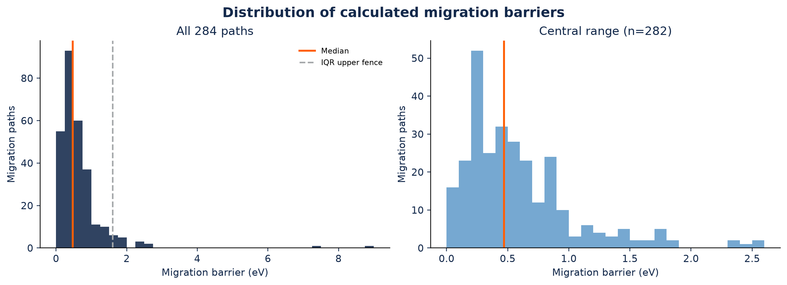
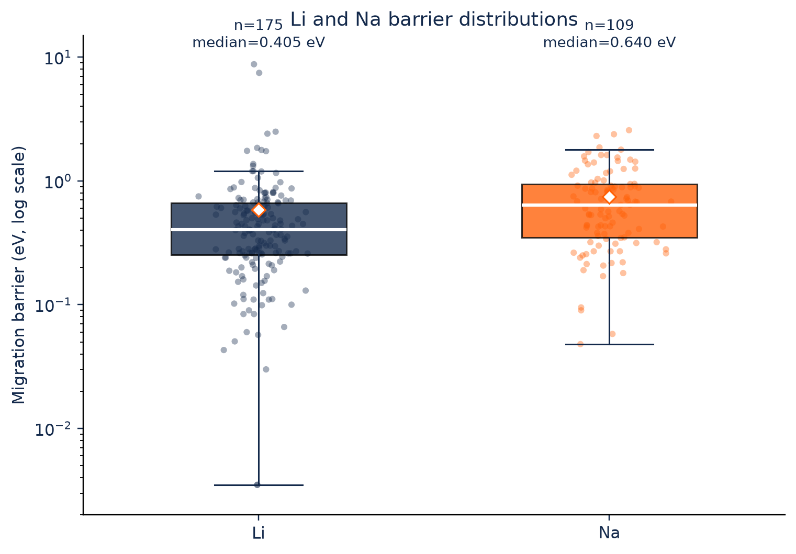
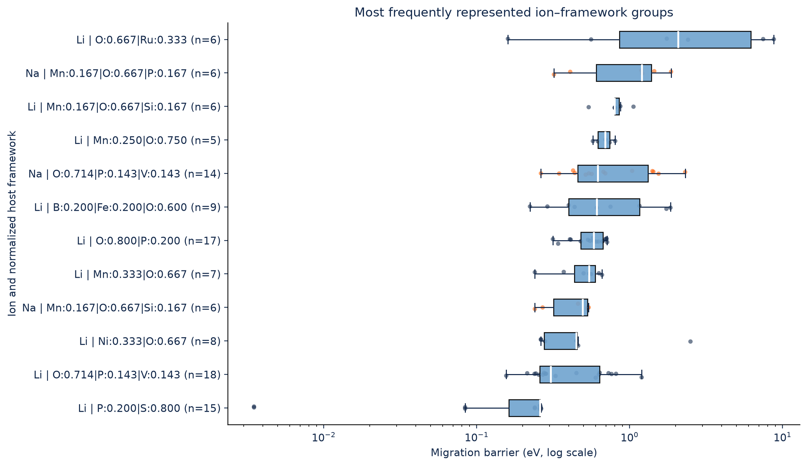
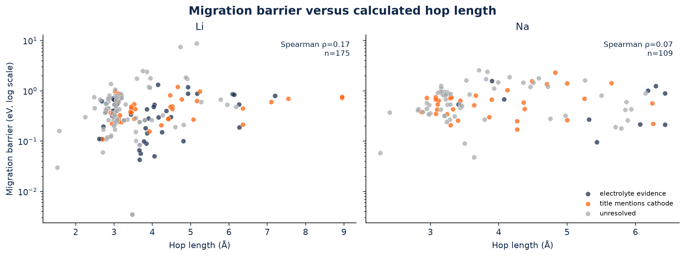

# Checkpoint 2 — Cathode Migration Barrier Analysis

## Scope and reproducibility

This checkpoint analyzes the existing `data/processed/cathode_migration_barrier_leads.csv` file without changing it. The target is the calculated DFT migration barrier, `migration_barrier_eV`. No value is converted to diffusivity or ionic conductivity, and no machine-learning model is trained.

The four figures can be reproduced from the repository root with:

```bash
MPLBACKEND=Agg MPLCONFIGDIR=/tmp/battery_checkpoint2_matplotlib \
  .venv/bin/python results/eda/checkpoint2_migration_analysis.py
```

Source dataset recorded in the CSV: Devi et al., DOI `10.1038/s41597-025-06196-x`, with the repository URL stored on every row.

## 1. Dataset structure and actual status values

The file has **284 rows and 23 columns**. Every `source_record_id` is unique, so the table contains 284 distinct reported migration paths. The five requested numeric fields are complete: barrier, hop length, cell volume, nominal mobile-ion number density, and mobile-ion atomic fraction have no missing values.

| Quantity | Count |
|---|---:|
| Migration paths / unique `source_record_id` | 284 |
| Unique material formulas | 169 |
| Unique `framework_key` values | 80 |
| Unique `(mobile_ion, framework_key)` groups | 111 |
| Identifiable `source_bibtex_key` values | 56 |
| Paths missing a paper key and source title | 6 |

`framework_key` contains normalized proportions of the non-mobile elements. The same host proportions can occur with both Li and Na, so there are 80 host keys but 111 ion–framework groups. For transport modeling, the 111 ion–framework groups are the safer independence unit because changing the mobile ion changes the prediction task.

### Li and Na coverage

| Mobile ion | Paths | Ion–framework groups | Identifiable paper keys |
|---|---:|---:|---:|
| Li | 175 | 60 | 36 |
| Na | 109 | 51 | 30 |

The identifiable-paper counts overlap because some papers contain both ions.

### Evidence and training-status fields

The status fields are internally consistent and should be interpreted literally:

| `cathode_role_evidence` | `auxiliary_barrier_training_status` | Paths | Meaning in this table |
|---|---|---:|---|
| `title_mentions_cathode` | `provisional_cathode_role` | 71 | The source title provides cathode evidence. This is still provisional and does not verify the exact phase or path. |
| `unresolved` | `needs_paper_review` | 159 | The available metadata did not establish cathode or electrolyte use. These rows are retained for review. |
| `electrolyte_evidence` | `exclude_from_cathode_task` | 54 | Available evidence indicates an electrolyte role. These remain useful for a general barrier task or domain comparison, but not as direct cathode examples. |

All 284 rows have:

- `direct_conductivity_training_eligible = False`. A migration barrier is not a conductivity label.
- `original_paper_review_required = True`. Even the 71 provisional cathode rows still require paper-level phase and path verification.

The 71 provisional cathode paths contain 34 formulas, 17 host framework keys, **19 ion–framework groups**, and 14 identifiable papers. They split into 38 Li and 33 Na paths, with 11 Li and 8 Na ion–framework groups.

## 2. Migration-barrier distributions

### Overall and Li/Na summaries

| Population | n | Mean (eV) | Median (eV) | Standard deviation (eV) | Minimum (eV) | Maximum (eV) |
|---|---:|---:|---:|---:|---:|---:|
| All paths | 284 | 0.645 | 0.470 | 0.785 | 0.0035 | 8.770 |
| Li | 175 | 0.582 | 0.405 | 0.909 | 0.0035 | 8.770 |
| Na | 109 | 0.745 | 0.640 | 0.516 | 0.0480 | 2.570 |
| Provisional cathode role | 71 | 0.572 | 0.479 | 0.383 | 0.1100 | 2.308 |
| Electrolyte evidence | 54 | 0.493 | 0.455 | 0.361 | 0.0430 | 1.580 |
| Unresolved role | 159 | 0.728 | 0.460 | 0.989 | 0.0035 | 8.770 |

The mean is much larger than the median because the distribution has a long upper tail. The unresolved subset has the highest standard deviation and contains 15 of the 16 high IQR outliers. The Li/Na difference is descriptive and cannot be assigned to ion identity alone because the ions occur in different mixtures of frameworks, crystal classes, and source papers.





### Framework-level variation

The figure below shows the 12 most frequently represented ion–framework groups. A logarithmic barrier axis keeps low and high values visible. Several groups have multiple paths but many others do not: 55 of the 111 ion–framework groups are singletons, 56 have at least two paths, and only 25 have at least three.

| Ion–framework group | n | Mean (eV) | Median (eV) | Standard deviation (eV) |
|---|---:|---:|---:|---:|
| Li, `O:0.714|P:0.143|V:0.143` | 18 | 0.465 | 0.306 | 0.282 |
| Li, `O:0.800|P:0.200` | 17 | 0.563 | 0.583 | 0.131 |
| Li, `P:0.200|S:0.800` | 15 | 0.200 | 0.260 | 0.100 |
| Na, `O:0.714|P:0.143|V:0.143` | 14 | 0.871 | 0.620 | 0.594 |
| Li, `B:0.200|Fe:0.200|O:0.600` | 9 | 0.829 | 0.610 | 0.616 |
| Li, `Ni:0.333|O:0.667` | 8 | 0.640 | 0.450 | 0.757 |
| Li, `Mn:0.333|O:0.667` | 7 | 0.501 | 0.544 | 0.148 |
| Na, `Mn:0.167|O:0.667|Si:0.167` | 6 | 0.428 | 0.495 | 0.138 |
| Li, `Mn:0.167|O:0.667|Si:0.167` | 6 | 0.812 | 0.800 | 0.167 |
| Na, `Mn:0.167|O:0.667|P:0.167` | 6 | 1.075 | 1.203 | 0.602 |
| Li, `O:0.667|Ru:0.333` | 6 | 3.520 | 2.080 | 3.676 |
| Li, `B:0.200|Mn:0.200|O:0.600` | 5 | 0.499 | 0.491 | 0.144 |



### Outlier review

Using the overall Tukey rule, Q1 is 0.26375 eV, Q3 is 0.80000 eV, and the upper review fence is **1.60438 eV**. The lower fence is negative, so it flags no low barriers. Sixteen paths exceed the upper fence; they are retained.

| Record | Ion | Formula | Barrier (eV) | Role evidence | Paper key |
|---|---|---|---:|---|---|
| `Devi2025:64` | Na | Na15Mn16O16F32 | 1.619 | unresolved | missing |
| `Devi2025:259` | Na | Na15Al16P16O64F16 | 1.620 | unresolved | `jalem2014alkali` |
| `Devi2025:368` | Na | Na1Ti16O16F32 | 1.709 | unresolved | missing |
| `Devi2025:61` | Li | Li127Fe128B128O384 | 1.740 | unresolved | `loftager2016density` |
| `Devi2025:199` | Li | Li1Ru24O48 | 1.750 | unresolved | `jung2014density` |
| `Devi2025:253` | Li | Li23Br8O8 | 1.778 | unresolved | `zhang2013ab` |
| `Devi2025:366` | Na | Na31Fe32P32O128 | 1.790 | unresolved | `kim2015unexpected` |
| `Devi2025:470` | Li | Li1Fe16B16O48 | 1.850 | unresolved | `loftager2016density` |
| `Devi2025:237` | Na | Na1Mn32P32O128 | 1.866 | unresolved | `zhu2023first` |
| `Devi2025:476` | Na | Na1V16P16O80 | 2.308 | provisional cathode | `lin2017comparison` |
| `Devi2025:152` | Na | Na1V16O16F32 | 2.384 | unresolved | missing |
| `Devi2025:4` | Li | Li23Ru24O48 | 2.410 | unresolved | `jung2014density` |
| `Devi2025:247` | Li | Li63Ni32O64 | 2.500 | unresolved | `kang2009first` |
| `Devi2025:24` | Na | Na1Cr16O16F32 | 2.570 | unresolved | missing |
| `Devi2025:115` | Li | Li1Ru16O32 | 7.470 | unresolved | `jung2014density` |
| `Devi2025:92` | Li | Li23Ru24O48 | 8.770 | unresolved | `jung2014density` |

The two 0.0035 eV Li–P–S records are not Tukey outliers, but their very small values and duplicated formula/paper combination also merit paper review. None of these values should be removed solely because it is extreme.

## 3. Potential predictive features

### Numeric descriptors

The following Spearman rank correlations are descriptive path-level associations. Paths from the same framework and paper are not independent, so the nominal p-values from an ordinary correlation test are not used as validation evidence.

| Feature | All paths ρ | Li ρ | Na ρ | Assessment for a preliminary model |
|---|---:|---:|---:|---|
| `hop_length_A` | 0.172 | 0.166 | 0.074 | Potentially useful but weak alone. A longer hop can increase the path cost, while bottleneck geometry, coordination, and topology are absent. |
| `cell_volume_A3` | −0.037 | −0.152 | 0.100 | Little stable marginal relationship. Raw cell volume depends on cell choice and should be secondary to normalized descriptors. |
| `mobile_ion_number_density_cm3` | 0.140 | 0.242 | −0.019 | Some Li-specific signal, but no Na signal. This is nominal occupied-ion density, not mobile-carrier density. |
| `mobile_ion_atomic_fraction` | −0.041 | 0.051 | −0.161 | Weak and inconsistent marginal relationship. |

`mobile_ion_number_density_cm3` and `mobile_ion_atomic_fraction` are strongly related to each other (Spearman ρ = 0.908). XGBoost can fit correlated inputs, but split importance or SHAP attribution may be unstable. They should be compared through an ablation rather than interpreted as independent physical effects.



### Mobile-ion identity

Both ions have useful path counts in the full dataset: 175 Li and 109 Na paths, with 60 and 51 ion–framework groups. A combined model can therefore include mobile-ion identity as a categorical input for a preliminary generic barrier task. The higher Na median does not demonstrate an intrinsic Na effect because framework and source-paper distributions differ.

### Crystal class

There are 29 `crystal_class` categories, many of them small. Among better represented classes, median barriers vary substantially: olivine is 0.290 eV (n=18), layered is 0.451 eV (n=23), phosphates are 0.565 eV (n=49), and oxides are 0.821 eV (n=28). Smaller categories such as `OXYFLUROIDES` have high medians but limited support. Crystal class may be useful as a one-hot categorical feature, but its spelling and definitions should be reviewed. The `ELECTROLYTES` class also encodes a material role rather than a purely structural descriptor and should not be used to support a cathode claim.

### Chemical composition

The normalized host framework keys contain 37 distinct non-mobile elements and two to four elements per path. Element presence shows broad descriptive differences: sulfur-containing hosts have a median of 0.260 eV versus 0.530 eV without sulfur; fluorine-containing hosts have 0.877 eV versus 0.449 eV without fluorine; and Ru-containing hosts have 1.326 eV versus 0.451 eV without Ru. These comparisons are confounded by framework, crystal class, paper, and the extreme Ru–O values.

For XGBoost, `framework_key` should be parsed into reproducible elemental fractions. The raw formula or framework string should not be treated as an arbitrary categorical ID: memorizing framework names would defeat a held-out-framework test.

### Physical meaning versus statistical use

- Hop length, nominal ion density, atomic fraction, composition, and structural class have plausible physical connections to migration, but none independently specifies the saddle-point environment.
- Unit-cell volume is a cell-representation variable unless normalized; a larger conventional cell does not imply a wider migration channel.
- Nominal ion density and atomic fraction describe occupied ions in the reported structure. They do not measure vacancy concentration or mobile-carrier concentration.
- `cathode_role_evidence`, `auxiliary_barrier_training_status`, paper identifiers, titles, and review flags are curation metadata. They must be used for selection, grouping, or reporting rather than as predictive features.

## 4. ML-readiness assessment

### 1. How many independent frameworks are available?

The file contains **80 unique host `framework_key` values** and **111 ion–framework groups**. Because Li and Na in the same normalized host are different transport tasks, 111 is the relevant upper bound for framework-grouped validation.

For the provisional cathode subset, the effective coverage is only **19 ion–framework groups from 14 identifiable papers**. Linking rows that share either an ion–framework or a paper produces only **11 connected groups**. The full dataset produces 41 such connected groups.

### 2. Are Li and Na sufficiently represented for a combined model?

For a preliminary **generic calculated-barrier model**, yes: both have more than 100 paths and more than 50 ion–framework groups in the full dataset. Mobile-ion identity must be explicit, and performance must be reported separately for Li and Na.

For a **cathode-specific model**, representation is limited to 38 Li and 33 Na paths across 11 and 8 ion–framework groups. This supports only a proof-of-process comparison, not a dependable cathode screening model.

### 3. Are there enough independent samples for meaningful grouped validation?

- Full generic barrier dataset: 111 ion–framework groups, but 55 are singletons. This is adequate for preliminary grouped validation.
- Conservative framework-and-paper grouping: only 41 connected groups remain. Grouped validation is still possible, but uncertainty across folds will be large.
- Provisional cathode subset: 19 ion–framework groups and 11 framework/paper connected groups. This is too small for stable five-fold model selection. At most, use three grouped folds plus leave-one-connected-group-out sensitivity, and label all results exploratory.

### 4. Which records should enter an initial training dataset?

Use two explicitly named datasets rather than mixing evidence roles silently:

1. **Primary cathode proof-of-process:** the 71 rows with `auxiliary_barrier_training_status = provisional_cathode_role`. This is the only current cathode-facing set, but every row remains provisional.
2. **Broad computed-barrier sensitivity set:** all 284 paths, with results stratified by cathode/electrolyte/unresolved role. This can test whether the feature pipeline learns a generic barrier relationship. It must not be described as a cathode model.

The 159 unresolved rows should remain in the repository and in the broad sensitivity analysis, but not in the primary cathode claim until paper review assigns their role. The 54 electrolyte-evidence rows should remain available for generic-barrier or domain-shift analysis and be excluded from the primary cathode dataset.

### 5. Which records require literature verification?

All 284 rows have `original_paper_review_required = True`. Review should be prioritized as follows:

1. The 71 provisional cathode rows, to confirm phase, state of charge, path, and cathode role.
2. The 159 unresolved rows, beginning with the 15 high IQR outliers and records that could expand underrepresented frameworks.
3. The six rows missing both a paper key and source title.
4. The two 0.0035 eV Li–P–S paths and the 7.47/8.77 eV Ru–O paths.

### 6. Main leakage risks

- **Same framework in train and validation:** multiple paths from one host can make path-level random splitting overly optimistic.
- **Same paper in train and validation:** shared DFT settings, supercell choices, and reporting conventions can be learned as source signatures.
- **Duplicate or closely related compositions:** formulas at different mobile-ion contents can share the same normalized host.
- **Role-coded features:** `cathode_role_evidence`, `auxiliary_barrier_training_status`, and the `ELECTROLYTES` crystal-class label can reveal curation decisions.
- **Identifier memorization:** raw framework strings, system names, record IDs, titles, and BibTeX keys can identify families or sources.
- **Outlier concentration:** several extreme Ru–O barriers come from one paper and framework family; random folds can place related examples on both sides.

Validation groups should therefore be connected components linking each `(mobile_ion, framework_key)` group to its `source_bibtex_key`. Missing paper keys require a conservative special handling and must never be used as ordinary predictive inputs.

## Recommended initial feature set

### Core features

1. `mobile_ion`, one-hot encoded as Li or Na.
2. `hop_length_A`.
3. Host elemental fractions parsed directly from `framework_key`.
4. `mobile_ion_number_density_cm3` as the initial nominal ion-content descriptor.
5. `crystal_class`, one-hot encoded after documenting spelling and category counts.

### Sensitivity or ablation features

- Replace or supplement number density with `mobile_ion_atomic_fraction`; their high correlation requires an explicit ablation.
- Test `cell_volume_A3` only as a secondary feature because it depends on cell representation.
- Compare models with and without `crystal_class`, especially the role-coded `ELECTROLYTES` category.

### Excluded predictive inputs

Do not use source IDs, system names, titles, BibTeX keys, `framework_key` as an opaque category, evidence/status fields, direct-conductivity eligibility, or review flags as model features.

## Recommended training-data strategy

Start with the 71 provisional cathode paths only to verify the grouped modeling workflow. Use framework-and-paper connected groups, report Li and Na separately, retain every outlier, and present the result as a small-sample proof of process. Then run the same fixed feature and validation design on all 284 paths as a generic-barrier sensitivity analysis. Do not use the broad result as evidence of cathode performance.

The dataset is suitable for preliminary grouped XGBoost method development, but it is not yet sufficient for a robust cathode barrier predictor. The limiting factor is the number of verified independent cathode frameworks and papers, rather than the raw count of migration paths.
