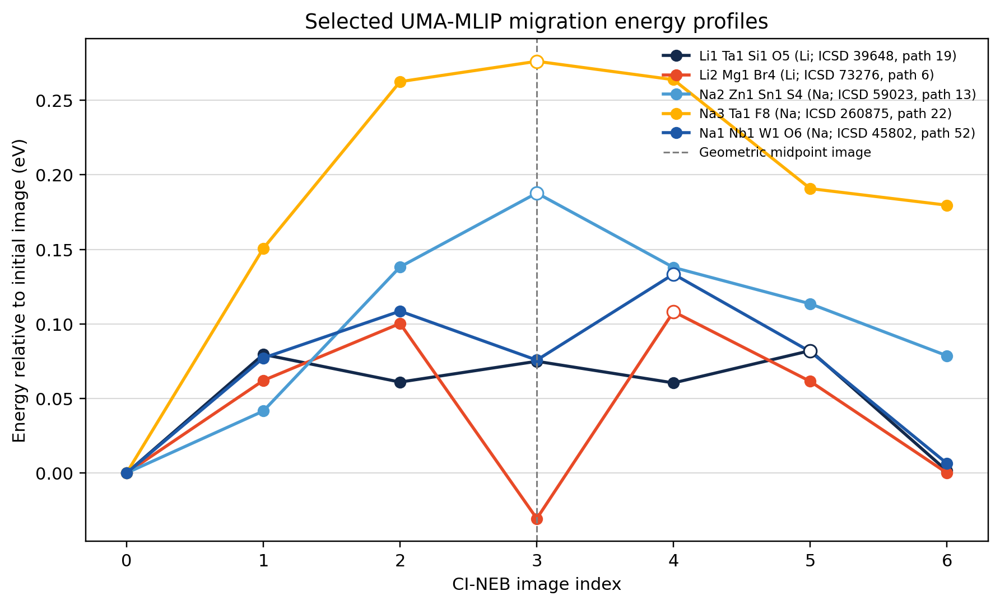

# Checkpoint 8 — Physics-Informed Descriptor Pilot

## Decision

Five Li/Na UMA-MLIP paths were audited without training a model. The pilot successfully reconstructs each seven-image energy profile, identifies the actual maximum-energy image, calculates forward and KRA barriers, and joins the path to the authors' tabulated distance-contraction, bottleneck, coordination-KRA, and Voronoi-KRA descriptors.

The local source folder does not contain the Figshare structure-image archive. Under this checkpoint's no-download restriction, atomic coordinates, hop distances, endpoint coordination, path coordination, minimum anion separation, and minimum path Voronoi volume could not be calculated. These values remain missing in [`physics_descriptor_pilot.csv`](physics_descriptor_pilot.csv); none was inferred from composition or filled with a proxy.

The main modeling conclusion is that the tabulated transition-state descriptors cannot be ordinary inputs for predicting the same UMA barrier. They are **post-migration explanatory descriptors** for the UMA target. They become valid **low-fidelity trajectory predictors** only in a separate task where the target is a higher-fidelity DFT barrier for the same path.

The analysis is reproducible with:

```bash
python results/ml/checkpoint8_physics_descriptor_pilot.py
```

No XGBoost, Random Forest, GNN, PINN, or neural-network model is trained.

## 1. Local source audit

The following files were available under `data/raw/computational_transport/`:

| File | Content used here |
|---|---|
| `UMA_NEB_energy.csv` | 22,365 absolute energies for 3,195 paths, exactly seven images per path |
| `figshare_32221506_metadata.json` | Figshare provenance, file list, checksum, and CC BY 4.0 license |
| `ADMA-38-e75410-s004.xlsx` | Authors' S1 descriptor/barrier table, extracted unchanged from the supplementary bundle already acquired in Checkpoint 7 |

The 104 MB `umaneb_data.zip` structure-image archive was not locally present and was not downloaded. The energy table alone does not contain coordinates, lattice vectors, atom identities, atomic ordering, endpoint positions, or hop vectors.

Primary sources:

- [Saravanan et al., *A Simple Descriptor for Solid-State Ionic Conductors Across Chemistries*](https://doi.org/10.1002/adma.75410)
- [Saravanan Figshare data](https://doi.org/10.6084/m9.figshare.32221506)
- [Dembitskiy et al., LiTraj](https://doi.org/10.1038/s41524-025-01571-z) and the [official LiTraj dataset documentation](https://github.com/AIRI-Institute/LiTraj)

## 2. Verified descriptor definitions

The definitions below follow the Saravanan Methods and S1 column semantics rather than an assumed geometric midpoint.

| Descriptor | Exact or operational definition | Physical interpretation | Required input | Availability class for barrier prediction |
|---|---|---|---|---|
| Hop distance | Minimum-image displacement between the initial and final mobile-ion equilibrium sites | Jump length and directional geometry | Endpoint structures, lattice, and migrating-ion correspondence | **Pre-migration predictor** when endpoints are proposed |
| Endpoint coordination | CrystalNN neighbor count at each equilibrium endpoint | Local site topology and endpoint asymmetry | Initial/final structures | **Pre-migration predictor** |
| Coordination along path | CrystalNN coordination evaluated for each path image; minimum or full profile must be stated | Coordination loss/gain at a bottleneck | Ordered trajectory structures | **Low-fidelity predictor** for DFT if obtained from UMA; **post-migration** for the same UMA target |
| Minimum anion separation | Smallest mobile-ion–anion distance among the specified images and neighbor rule | Steric bottleneck/anion repulsion | Ordered path structures and anion classification | Same category as the trajectory supplying it |
| Distance contraction, Δd | For each neighboring species \(j\), compare the nearest mobile-ion–species distance at the selected path position with its equilibrium reference, then take the maximum: \(\Delta d=\max_j(d_{i-j}^{eq}-d_{i-j})\) | Largest local contraction and short-range repulsion penalty | Equilibrium reference distances plus selected path position | Context dependent; see below |
| Δd at the UMA transition state | The paper uses the UMA-NEB TS mobile-ion position with other framework atoms at their original unrelaxed positions. \(d^{eq}\) is the average neighbor distance over equilibrium end sites for species \(j\) | TS-local contraction without including full framework relaxation in the descriptor | Completed UMA path to locate TS plus host structure | **Post-migration explanatory** for UMA; **low-fidelity predictor** for DFT |
| Anion/cation Δd | Apply the same maximum separately to anion species or cation species. Negative values are retained when all relevant distances expand | Separates anion bottleneck constriction from framework-cation repulsion | Same as Δd plus species roles | Same as the parent Δd |
| Predicted-path Δd | Remove all mobile ions from the host; interpolate five images; minimize Δd in transverse directions using neighbors within 5 Å; select the path with lowest maximum Δd. The predicted TS is the position of maximum Δd along that path | Structure-only estimate of favorable path and bottleneck | Host structure and candidate endpoint sites; no NEB energy profile | **Pre-migration predictor**; not implemented here |
| Bottleneck radius at TS | Largest spherical radius that can pass through the local void without overlap | Free-space aperture at the bottleneck | TS/path position and host geometry | **Post-migration** for UMA TS; predicted-path version could be pre-migration |
| Coordination-KRA | Saravanan coordination descriptor transformed as \(D_{TS}-(D_{IS}+D_{FS})/2\) | Change in coordination relative to endpoints | IS, FS, and TS structures | Same fidelity/category as the TS source; not an endpoint coordination count |
| Voronoi volume-KRA | VoronoiNN site volume transformed with the KRA descriptor expression | Change in local free volume relative to endpoints | IS, FS, and TS structures | Same fidelity/category as the TS source |
| Minimum path Voronoi volume | Minimum Voronoi volume over a specified ordered path | Tightest local free-volume region | All path structures | Low-fidelity or post-migration according to path source; not present in S1 |
| LiTraj centroid representation | Supercell with a dummy `X` placed at the centroid of the start/end Li sites; LiTraj uses it as a structure-to-barrier representation | Encodes endpoints and local host near a proposed hop | Structure and endpoints | **Pre-migration predictor**, but the centroid is not asserted to be the TS |

Saravanan's neighbor search uses separate anion and cation cutoffs. The anion cutoff is the maximum mobile-ion–anion nearest-neighbor distance from CrystalNN plus 0.5 Å; the cation cutoff is the largest species-specific minimum mobile-ion–cation distance plus 0.5 Å. The reported Δd aggregation is a **maximum**, not an average.

For the completed UMA path, the energy transition state is identified from the CI-NEB path rather than assumed to be image 3. For the separate predicted-path Δd algorithm, the predicted TS is the point of maximum Δd, not automatically the geometric midpoint.

## 3. Representative paths

Five paths were selected to cover both mobile ions, oxide/sulfide/halide environments, endpoint energy asymmetry, and different locations of the maximum-energy image.

| ICSD | Path | Formula | Ion | Host family | Images | Max-energy image | Midpoint? | Recomputed forward barrier (eV) | Recomputed KRA barrier (eV) |
|---:|---:|---|---|---|---:|---:|---|---:|---:|
| 39648 | 19 | Li1 Ta1 Si1 O5 | Li | oxide | 7 | 5 | No | 0.082062 | 0.081360 |
| 73276 | 6 | Li2 Mg1 Br4 | Li | bromide | 7 | 4 | No | 0.108200 | 0.108204 |
| 59023 | 13 | Na2 Zn1 Sn1 S4 | Na | sulfide | 7 | 3 | Yes | 0.187764 | 0.148442 |
| 260875 | 22 | Na3 Ta1 F8 | Na | fluoride | 7 | 3 | Yes | 0.276123 | 0.186317 |
| 45802 | 52 | Na1 Nb1 W1 O6 | Na | oxide | 7 | 4 | No | 0.133383 | 0.130198 |

The maximum-energy image differs from the interpolated midpoint for **three of five** paths. This directly confirms that image 3 cannot be used as a universal TS shortcut.

The energy CSV has all seven image labels and energies for each selected path. Initial and final mobile-ion positions, intermediate structures, atom ordering, and identity consistency cannot be verified without the locally absent structure archive. The CSV records `atomic_order_consistency_verified = False` rather than assuming consistency.

### Path-to-supplement matching

S1 identifies ICSD, composition, ion sheet, forward barrier, KRA barrier, and descriptors, but does not include the Figshare path ID. Each selected path was joined within its ICSD using the minimum combined absolute error between recomputed and S1 forward/KRA barriers.

- All five combined matching errors are below 0.0016 eV.
- The output retains the supplement sheet, one-based spreadsheet row, and match error.
- This is a rounded numeric crosswalk, not a native path identifier; it must be replaced with a direct structure/path crosswalk if the archive provides one.

## 4. Implemented and missing outputs

### Successfully implemented

- Parsing `structure_path_image_relax` identifiers.
- Seven-image completeness and ordering checks for all 3,195 paths.
- Maximum-energy image from `argmax(E)`.
- Forward barrier \(E_{TS}-E_{IS}\).
- KRA barrier \(E_{TS}-(E_{IS}+E_{FS})/2\).
- Endpoint energy asymmetry \(E_{FS}-E_{IS}\).
- Relative energy profile for every selected path.
- Rounded barrier-pair crosswalk to S1.
- Source-provided total, anion, and cation Δd.
- Source-provided TS bottleneck radius, coordination-KRA, and Voronoi-volume-KRA.
- Per-field provenance, fidelity, availability category, and missing-data reason.

### Explicitly missing

The following fields are empty for all five paths:

- Initial and final mobile-ion fractional positions.
- Hop distance.
- Initial and final coordination.
- Minimum coordination along the path.
- Minimum anion distance.
- Minimum path Voronoi volume.

They require atomic images and cannot be reconstructed from seven scalar energies or formula strings. The source's `CN-KRA` is not substituted for initial/final coordination, and `Voronoi volume-KA` is not relabeled as a minimum path volume.



The open circles indicate each actual maximum-energy image. The dashed line marks the geometric midpoint only for comparison.

## 5. Comparison with the current XGBoost features

| Current feature | Candidate descriptor | New physical information | Redundancy | Candidate-structure availability | Calculation required |
|---|---|---|---|---|---|
| Hop length | Exact endpoint hop vector/distance | Adds direction and anisotropy if the vector is retained | Scalar distance duplicates the existing feature if calculated the same way | Yes, once endpoints are enumerated | Structure parsing only |
| Hop length | Predicted-path curvature and transverse displacement | Distinguishes curved and direct paths with similar endpoint distance | Genuinely new | Yes, with host structure and proposed endpoints | Saravanan predicted-path geometry algorithm |
| Host elemental fractions | Endpoint coordination and species-resolved neighbor counts | Local topology and chemistry around the hop | Genuinely new; composition cannot identify the local site | Yes | CrystalNN or a documented lighter rule |
| Host elemental fractions | Anion/cation predicted Δd | Local short-range constraint by chemical role | Genuinely new | Yes in principle | Predicted-path Δd; no NEB energies |
| Mobile-ion density | Vacancy fraction and endpoint-site availability | Local carrier/site state rather than bulk nominal density | Partly related but materially more local | Requires an explicit defect/SOC structure | Structure/site analysis |
| Mobile-ion identity | Anion/cation distance contraction | Ion-size/host interaction at the bottleneck | Genuinely new | Predicted version is candidate-ready; UMA-TS version is not | Host-only path search or MLIP path |
| None | Predicted bottleneck radius or minimum anion clearance | Local free-space geometry | Genuinely new | Yes with endpoints and host structure | Geometry calculation |
| None | UMA-trajectory Δd, coordination profile, path minimum volume | Relaxed low-fidelity pathway response | Genuinely new | No, not without an approximate trajectory | UMA-MLIP NEB; valid for a DFT target only |

The source TS descriptors contain useful physics but would leak the UMA migration outcome into an UMA-barrier model. Their proper immediate use is:

1. mechanistic diagnosis of the UMA dataset; or
2. multi-fidelity prediction of a separate DFT barrier for exactly matched paths.

## 6. Recommendation for the next XGBoost iteration

The next XGBoost matrix should contain only **pre-migration predictors**:

1. Mobile-ion identity.
2. Existing normalized host elemental fractions.
3. Existing nominal mobile-ion density, with its carrier-density limitation documented.
4. Exact endpoint hop distance/vector after paths are enumerated.
5. Initial/final CrystalNN coordination and coordination difference.
6. Predicted-path Δd total, anion, and cation components calculated from the host framework without NEB energies.
7. Predicted-path bottleneck/minimum anion clearance.
8. A network-connectivity or percolation descriptor when multiple candidate hops are available.

Do not add the S1 `distance_deviation-TS`, `bottleneck_radius-TS`, `CN-KRA`, or `Voronoi volume-KA` columns to a model targeting the same UMA barrier. If the project later builds a paired UMA→DFT calibration dataset, these columns can enter a distinct low-fidelity trajectory feature block with path-grouped validation and explicit fidelity labels.

## Completion status

- Descriptor definitions: verified from the original paper and supplement.
- Representative trajectories: five energy paths selected across Li/Na and four host families.
- Energy/path prototype: executed and verified.
- Δd implementation: source values joined and definition verified; independent geometry recomputation blocked by absent structures.
- Voronoi implementation: not attempted because structure images are absent; no heavy dependency was installed.
- Feature categories: separated into pre-migration, low-fidelity trajectory, and post-migration explanatory uses.
- Model training: not performed.
